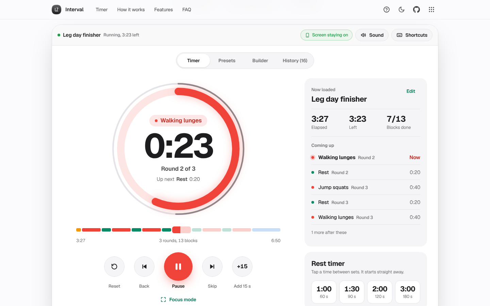

# Interval

A workout timer you can read from across the room.

[](https://lz-interval.pages.dev/)

Mirror: https://lazarzec18.github.io/interval/



## Features

**Timer**
- A large progress ring with the time left in the block, the block name, the round ("Round 3 of 8") and what is up next.
- An outer ring that fills over the whole session, and a timeline of every block, coloured by type. Select any block to jump to it.
- The ring and the start button change colour by phase: work, rest, prep and cool-down.
- A 3-2-1 countdown before you start, then start or pause, back, skip, reset and +15 s.
- Focus mode: full screen, with digits sized to the display, for a phone on a bench or a TV across the room.
- Keeps the screen awake while running (Screen Wake Lock), with its status shown in the app bar.

**Cues**
- Web Audio beeps at 3, 2 and 1, with a different tone for work, rest, prep, cool-down and done.
- Optional voice cues ("Round 2. Burpees", "Rest", "Halfway", "Done") and vibration on phones that support it.
- A settings panel with volume, test buttons and toggles for each cue.

**Presets**
- Rest timer with one-tap 1:00, 1:30, 2:00 and 3:00.
- Tabata 20/10 x 8, EMOM 10 min, HIIT 30/30 x 10, boxing rounds 3:00/1:00 x 6, Pomodoro 25/5 x 4 and a 5-minute stretch flow.

**Builder**
- Named work, rest, prep and cool-down blocks with minutes:seconds durations and inline errors.
- A repeat group (for example blocks 2 to 3, 8 times), with an option to drop the final rest.
- Drag to reorder (mouse or touch), plus move up and down buttons for the keyboard. Duplicate, and delete with undo.
- A live total time, then save as a named workout. Edit or delete saved workouts later.

**History**
- Every finished or stopped session is saved with its name, date, time trained and whether it was finished.
- Minutes trained by day or by week as a bar chart with tooltips, your current and best streak of active days, and your finish rate.

**Keyboard**
- Space start or pause, N skip, B back, R reset, F focus mode, ? shortcut sheet.

## How it works

The timer never counts ticks. It stores how much time had passed when you last paused, plus the moment you resumed, and works out everything else from the clock: elapsed time is `paused + (now - resumedAt)`, and the current block is found from cumulative block offsets. Skip, back, jumps and +15 s simply change those numbers. Because nothing accumulates, there is no drift, and a tab that was asleep for five minutes lands in exactly the right block when it wakes. The clock is `performance.now()`, with a check against `Date.now()` that adds any gap caused by the device sleeping.

Each animation frame (and a 200 ms interval as a backup for hidden tabs) asks the timer what has happened since the last check. It reports thresholds that were crossed, such as the 3-2-1 marks, block changes, the halfway point and the end, and the app turns those into tones, speech and vibration. If the gap is long (the tab was in the background), the timer catches up quietly instead of firing a burst of beeps.

Workouts are a list of blocks plus an optional repeat group. They expand into a flat list of timed segments, which keeps the timer simple and makes the builder's total and the timeline exact. Everything is saved in your browser, including a running session, so a reload picks up paused where you left off.

## Tech

- Vanilla HTML, CSS and JavaScript. No framework and no build step.
- Web Audio API for tones, Speech Synthesis for voice, Vibration API, Screen Wake Lock API and Fullscreen API.
- SVG for the ring, timeline and chart. CSS container query units scale the digits with the ring.
- The shared Zec Labs kit (`zl.css`, `zl.js`) for layout, components, toasts, dialogs, the guided tour and storage.

## Run locally

```sh
python3 -m http.server
```

Then open http://localhost:8000.

## Project structure

| File | What it does |
| --- | --- |
| `index.html` | Page structure: hero, the app, how it works, features and FAQ |
| `engine.js` | Workout model, repeat-group expansion, presets, time parsing and the drift-free timer |
| `cues.js` | Web Audio tones, speech and vibration |
| `app.js` | Timer view, presets, settings, wake lock, focus mode, keyboard and the tour |
| `builder.js` | Block editor, repeat group, drag reorder and saved workouts |
| `history.js` | Session history, streaks and the minutes chart |
| `styles.css` | App styles on top of the kit |
| `zl.css`, `zl.js` | Shared Zec Labs design kit |

## Testing

A Python Playwright suite (169 checks) runs the app in Chromium with a controlled clock:

- Runs a custom workout through every phase (countdown, prep, two rounds of work and rest with the final rest skipped, cool-down) and checks the block order, round labels, sound, voice and vibration cues, and that the finished session lands in history.
- Pause and resume keep the remaining time, skip and back behave as described, +15 s extends the block and total, and a timeline click jumps to a block.
- Elapsed time matches the clock exactly across uneven frame steps, and the timer catches up correctly after a 25-second gap.
- Repeat groups expand correctly (including skipping the final rest), every preset's length is correct, and duration parsing handles each format.
- The builder: add, duplicate, delete with undo, move buttons, drag reorder, inline errors, total time, save, edit and delete saved workouts.
- Keyboard shortcuts, focus mode, the shortcut sheet, settings, wake lock requests and releases, history chart, tooltips and deletes.
- Data persists across reloads, including a paused session. The guided tour's steps all have visible targets. No horizontal overflow at 390 px, inputs are at least 16 px, and there are no console errors.

---

Part of Zec Labs, a set of small, polished web apps by [Lazar Zec](https://github.com/LAZARZEC18). See them all at https://lazarzec.pages.dev/
